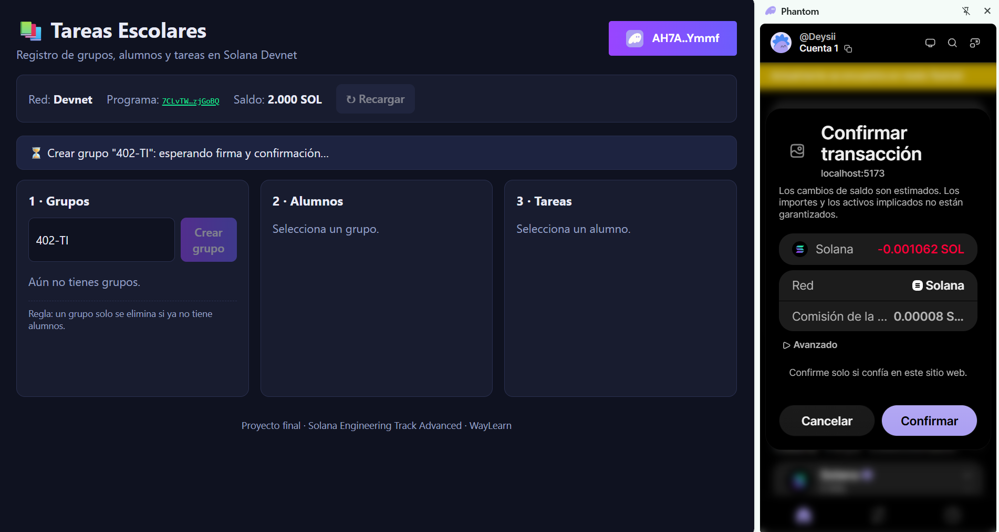
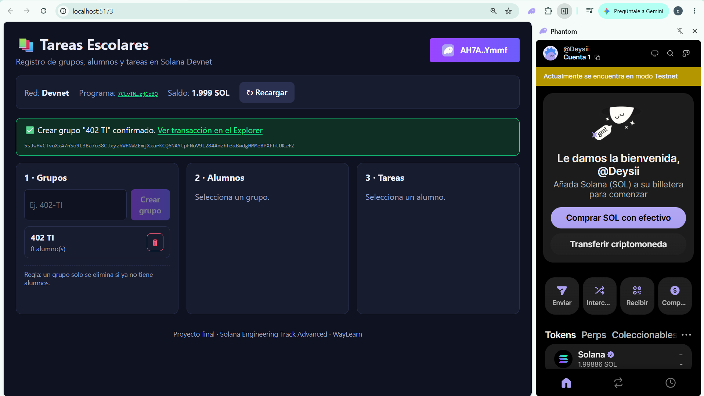
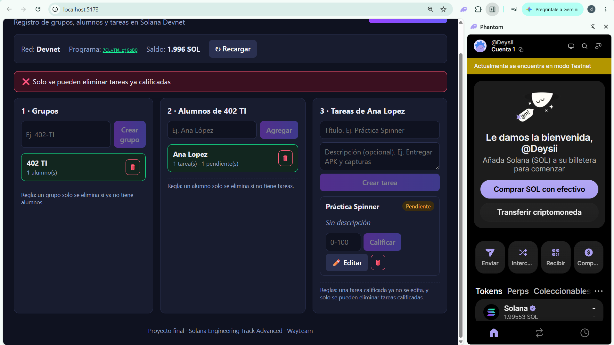

# 📚 Tareas Escolares en Solana

Proyecto final del **Solana Engineering Track: Advanced (WayLearn)**.

| Dato | Valor |
|---|---|
| **Ruta elegida** | Proyecto propio |
| **Nombre para el certificado** | `DEYSI YANEL BAUTISTA PINEDA` |
| **Correo de registro** | `deysipinedam134@gmail.com` |
| **Red** | Devnet |
| **Program ID** | `7CLvTWMLF7E5pFpxYNn1rZHr4rPimoDWzhKDXUzjGoBQ` |
| **Transacción verificable** | `https://explorer.solana.com/tx/5sJwHvCTvuXxA7nSo9L3Ba7o38CJxyzhWfNWZEmjXxarKCQ6NAYtpFNoV9L284Amzhh3xBwdgHMMeBPXFhtUKzf2?cluster=devnet` |

---

## 1. Propósito

Una app para que un **profesor** registre en la blockchain sus **grupos**, los **alumnos** de cada grupo y las **tareas** de cada alumno, con su calificación.
Cada registro es una cuenta de Solana (PDA) ligada a su "padre", y solo el profesor que creó el grupo puede modificarla.

```
Profesor (wallet)
  └── Grupo   PDA ["grupo",  profesor, nombre]
        └── Alumno  PDA ["alumno", grupo, nombre]
              └── Tarea   PDA ["tarea", alumno, titulo]
```

## 2. Estructura del repositorio

```
programa/lib.rs              Programa en Rust + Anchor (se despliega con Solana Playground)
idl.json                     IDL del programa (genera el cliente)
clients/js/src/generated/    Cliente TypeScript generado con Codama (no editar a mano)
scripts/                     generar-cliente.mjs · configurar-idl.mjs
src/solana/
  config.ts                  Program ID, RPC y límites
  seeds.ts · pdas.ts         Derivación de direcciones PDA
  lecturas.ts                Lecturas por RPC (getProgramAccounts + decoders de Codama)
  acciones.ts                Construcción de instrucciones con el cliente Codama
  tx.ts                      Simulación, firma con la wallet, envío y confirmación
  validaciones.ts            Mismas reglas del programa, validadas antes de firmar
  errores.ts                 Traduce errores del programa/wallet a mensajes en español
src/components/              Paneles de Grupos, Alumnos, Tareas y barra de estado
tests/cliente.test.ts        Pruebas del cliente (Vitest, sin transacciones)
tests-playground/anchor.test.ts  Pruebas del programa en Devnet (Solana Playground)
```

## 3. Instrucciones del programa

| Instrucción | Qué hace | Reglas que valida el programa |
|---|---|---|
| `crear_grupo(nombre)` | Crea el grupo; el firmante queda como profesor | Nombre de 1 a 32 bytes |
| `agregar_alumno(nombre)` | Crea un alumno dentro del grupo | Solo el profesor · nombre 1-32 bytes |
| `crear_tarea(titulo, descripcion)` | Crea una tarea pendiente para el alumno | Solo el profesor · título 1-32 · descripción ≤ 200 |
| `editar_tarea(descripcion)` | Cambia la descripción | Solo el profesor · **no si ya está calificada** |
| `calificar_tarea(calificacion)` | Marca la tarea como calificada | Solo el profesor · **0 a 100** |
| `eliminar_tarea()` | Cierra la cuenta y devuelve la renta | Solo el profesor · **solo si está calificada** |
| `eliminar_alumno()` | Cierra la cuenta del alumno | Solo el profesor · **solo si no tiene tareas** |
| `eliminar_grupo()` | Cierra la cuenta del grupo | Solo el profesor · **solo si no tiene alumnos** |

**Permisos y propiedad de cuentas:** cada cuenta se valida con `seeds` + `bump` y `has_one`:
el grupo debe pertenecer al firmante (`has_one = profesor`), el alumno al grupo (`has_one = grupo`) y la tarea al alumno (`has_one = alumno`).
Las cuentas se cierran con `close = profesor`, así la renta regresa a su wallet.
Los contadores (`total_alumnos`, `total_tareas`, `tareas_pendientes`) usan `checked_add/sub`.

## 4. Mi contribución

Es un proyecto propio, no una modificación del registro de ventas. Hice lo siguiente:

- Diseñé el modelo de tres niveles **Grupo → Alumno → Tarea** con PDAs encadenadas.
- Escribí las **8 instrucciones**, con cierre condicionado a reglas de negocio (no borrar lo que todavía tiene "hijos" y no borrar tareas sin calificar).
- Agregué el flujo de **calificación**: una tarea calificada ya no se puede editar y descuenta las pendientes del alumno.
- Generé el cliente con **Codama** a partir del IDL y lo conecté a un frontend **React + Wallet Adapter**.
- El frontend **simula la transacción antes de pedir la firma**, así que si el programa la rechaza se muestra el motivo en español sin gastar SOL.
- Escribí pruebas del cliente (Vitest) y pruebas del programa en Devnet con **casos de rechazo**.
- Usé IA como apoyo para generar parte del código; revisé cada instrucción, corregí los errores que aparecieron al probar (pantalla en blanco por `process` y el envío con Phantom en Devnet) y verifiqué el flujo completo y los rechazos en Devnet.

## 5. Despliegue del programa (Solana Playground)

1. Abre <https://beta.solpg.io>, crea un proyecto **Anchor (Rust)** y pega `programa/lib.rs` en `src/lib.rs`.
2. Conéctate a **Devnet** con el botón "Not connected" (eso crea la wallet de Playground). Pide SOL con `solana airdrop 2` en la terminal o en <https://faucet.solana.com>.
3. Haz clic en **Build** y luego en **Deploy**. Copia el **Program ID** y pégalo en la tabla de arriba.
4. (Opcional) Copia `tests-playground/anchor.test.ts` a la carpeta `tests/` de Playground y presiona **Test**. Las firmas de las transacciones aparecen en la consola.
5. (Solo si modificaste el programa) Exporta el IDL desde Playground y guárdalo como `tmp-idl/tareas_escolares.json`.

## 6. Configuración y ejecución del frontend

Requisitos: **Node.js 22.12 o superior**, una wallet en el navegador (Phantom, Solflare o Backpack) configurada en **Devnet** y con algo de SOL.

```bash
npm ci
# Opción A (recomendada): el idl.json del repo ya corresponde a programa/lib.rs; solo falta tu Program ID
npm run configurar:idl -- --program-id <TU_PROGRAM_ID>
# Opción B: importar el IDL exportado de Playground
# npm run configurar:idl -- ./tmp-idl/tareas_escolares.json --program-id <TU_PROGRAM_ID>
npm run dev
```

> Si cambias `programa/lib.rs`, vuelve a exportar el IDL de Playground y usa la opción B.

Abre <http://localhost:5173> y conecta tu wallet.

**En Codespaces:** Code → Codespaces → Create codespace. El contenedor instala las dependencias y genera el cliente solo. Luego ejecuta `npm run dev` y abre el puerto 5173 en una pestaña donde tengas la wallet.

Variables opcionales: copia `.env.example` a `.env.local` y pon `VITE_RPC_URL` si quieres usar otro RPC de Devnet.

Otros comandos:

| Comando | Para qué |
|---|---|
| `npm run cliente` | Regenera el cliente Codama desde `idl.json` |
| `npm test` | Pruebas del cliente |
| `npm run verificar` | Revisión de tipos + pruebas + build |

## 7. Cómo probar y verificar

**Pruebas automáticas**
- `npm test`: comprueba las PDAs, las validaciones, que las instrucciones usen el discriminador del IDL y la traducción de errores (9 pruebas).
- Playground → **Test**: hace el flujo completo en Devnet y 6 casos de rechazo (`TareaNoCalificada`, `CalificacionInvalida`, `GrupoConAlumnos`, otra wallet intentando calificar, `TareaYaCalificada` y `AlumnoConTareas`).

**Prueba manual en el frontend**
1. Crea el grupo `402-TI` → aprueba en la wallet → aparece el enlace al Explorer.
2. Selecciónalo y agrega al alumno `Ana López`.
3. Selecciona a Ana y crea la tarea `Práctica Spinner`.
4. Intenta **eliminarla**: el programa la rechaza con *"Solo se pueden eliminar tareas ya calificadas"*.
5. Califícala con `95` y después intenta **editarla**: se rechaza con *"No se puede editar una tarea ya calificada"*.
6. Intenta eliminar el grupo: se rechaza porque todavía tiene alumnos.
7. Elimina la tarea, luego al alumno y luego el grupo: las tres operaciones se confirman y las listas se actualizan.

Cada operación confirmada muestra su firma con un enlace a `explorer.solana.com` (devnet). También puedes revisar cualquier cuenta buscando su dirección en el Explorer.

## 8. Evidencias

Todas las operaciones se pueden verificar en el historial del programa:
https://explorer.solana.com/address/7CLvTWMLF7E5pFpxYNn1rZHr4rPimoDWzhKDXUzjGoBQ?cluster=devnet

| Operación | Firma (Devnet) |
|---|---|
| crear_grupo | [`5sJwHvCTvuXxA7nSo9L3Ba7o38CJxyzhWfNWZEmjXxarKCQ6NAYtpFNoV9L284Amzhh3xBwdgHMMeBPXFhtUKzf2`](https://explorer.solana.com/tx/5sJwHvCTvuXxA7nSo9L3Ba7o38CJxyzhWfNWZEmjXxarKCQ6NAYtpFNoV9L284Amzhh3xBwdgHMMeBPXFhtUKzf2?cluster=devnet) |
| agregar_alumno | `PEGA_AQUI_58QBr...xzuiG` |
| crear_tarea | `PEGA_AQUI_5wE4M...qu2xt` |
| calificar_tarea | `PEGA_AQUI_4j4n3...26hh3` |
| eliminar_tarea | `PEGA_AQUI_2vSNp...iMzR9` |
| Rechazo: eliminar tarea sin calificar | El programa lo rechaza en la simulación y no se envía. Ver `images/rechazo.png` |





## 9. Tecnologías

Rust · Anchor 0.30 · Solana Playground · Codama · @solana/kit · @solana/web3.js · Wallet Adapter · React 19 · Vite · TypeScript · Vitest
